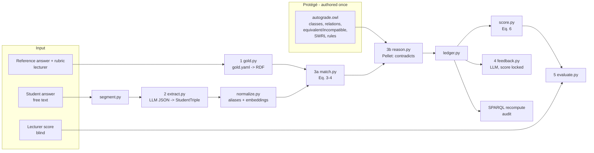

# AutoGrade-RDF — Prototype Design & Implementation Plan

> **Audience:** coding agents (and the student team) working in VS Code.
> **Project:** Topic 4 — *Penilaian Esai Pendek yang Dapat Diaudit melalui Pencocokan Triple RDF Berbobot Rubrik*.
> **Goal of the prototype:** compute a short-answer score **deterministically** from a ledger of RDF triple matches weighted by a lecturer's rubric, detect limited contradictions with SWRL, and let an LLM write feedback **only** from the ledger. Then compare scores with lecturer grades.
>
> This file is the single source of truth. Agents must follow the **Agent Rules** (Section 1) and complete phases in order. Each phase ends with acceptance checks that must pass before moving on.

---

## 0. Tool choice (summary)

| Need | Tool | Why |
|---|---|---|
| Ontology (TBox) and SWRL rules | **Protégé Desktop 5.6.4** with the bundled **SWRLTab** plugin | Professor's suggestion. It is the standard OWL editor, and SWRLTab comes preinstalled from Protégé 5.6.0 onward. Used to design, inspect and sanity-check the ontology. Figures for the article come from here. |
| Run SWRL inside the pipeline | **Owlready2** + **Pellet** (bundled; needs Java) | Loads the Protégé ontology in Python and executes SWRL rules. Pellet is required for inferring property values (`infer_property_values=True`). |
| RDF data, Turtle, SPARQL | **rdflib** | Stores gold, student and ledger graphs. The SPARQL score-recompute query runs here (this is the audit mechanism). |
| Triple extraction (NLP/IE) | **LLM with structured JSON output**, constrained to a controlled predicate list | Indonesian free text → `(subject, predicate, object, negated, sentence_id)`. Provider-agnostic wrapper. |
| Semantic similarity of concepts | **sentence-transformers** with a multilingual model (default `paraphrase-multilingual-MiniLM-L12-v2`; verify Indonesian coverage on the model card) | Cosine similarity for subject/object alignment after alias normalization. |
| Feedback writing | Same LLM wrapper | Reads ledger JSON only; cannot change scores. |
| Evaluation | **scipy**, **numpy**, **pandas** | Pearson, Spearman, MAE, RMSE, plus audit metrics (EP, ER, FF). |
| Demo UI (manual and video) | **Streamlit** | Quick, screenshot-friendly UI for the user manual (≥300 dpi captures) and demo video. |
| Data validation | **pydantic** | Typed schemas for every intermediate file. |
| Tests | **pytest** | One test module per pipeline module. |
| Editor | **VS Code** + Python extension | Team's environment. |

**Division of labour between Protégé and Python**

- **Protégé (by a human):** classes, properties, relation individuals (predicates), `equivalentPredicate` / `incompatibleWith` assertions, and SWRL rules. Saved as **RDF/XML**. Owlready2 loads SWRL rules only from RDF/XML or N-Triples, not OWL/XML.
- **Python (by agents):** everything per answer. That covers converting the gold YAML into RDF individuals, extraction, matching, reasoning calls, scoring, ledger, feedback, evaluation and UI.
- **Gold triples are authored in YAML, not in Protégé.** A reified triple needs about 6 assertions, which is tedious in the Protégé UI and hard for a lecturer to review. A script converts the YAML to RDF, and the result can be opened in Protégé for inspection and screenshots.

---

## 1. Agent Rules (non-negotiable)

1. **The LLM never decides the score.** The score is computed only by `score.py` using Equation (6). LLM output must never be parsed as a number that affects the score. The only exception is baseline B2 (`baselines.py`), which is reported as a comparison and never feeds the system score.
2. **Do not change the formulas** in Section 4 without a human decision recorded in `docs/DECISIONS.md`.
3. **Parameters are frozen after calibration.** `tau_h`, `tau_l`, `delta`, `lambda` are tuned only on the pilot split. Once `config/frozen.yaml` exists, agents must not edit it.
4. **No fabricated data.** Synthetic answers must be stored under `data/synthetic/` and flagged `synthetic: true`. Never mix them into evaluation results reported as real.
5. **Every ledger entry must be traceable.** It needs a reference triple ID, a criterion ID, a weight, a status, a credit, and the source sentence IDs, or null when the status is `MISSING`.
6. **Open-world assumption.** A missing triple is `MISSING`, never `CONTRADICTED`.
7. **Determinism.** Use LLM temperature 0, a fixed embedding model version, and a fixed random seed. Cache every LLM response to `outputs/cache/` keyed by a hash of (provider, model, temperature, JSON schema, system prompt, user prompt), so a model change never returns stale answers.
8. **Secrets.** API keys come from `.env` only. Never commit `.env`.
9. **Keep Indonesian content in data, English in code.** Identifiers, comments and docs are in English. Concept labels and answers stay in Indonesian.
10. When a phase's acceptance checks fail, fix them before starting the next phase.

---

## 2. Repository layout

```
autograde-rdf/
├── PROTOTYPE_PLAN.md            # this file
├── README.md
├── pyproject.toml               # or requirements.txt
├── .env.example                 # LLM_API_KEY=..., LLM_PROVIDER=..., LLM_MODEL=...
├── config/
│   ├── config.yaml              # paths, model names, initial parameters
│   ├── frozen.yaml              # created by calibration; read-only afterwards
│   └── predicates.yaml          # controlled predicate vocabulary + aliases
├── ontology/
│   ├── autograde.owl            # RDF/XML, authored in Protégé (TBox + relations + SWRL)
│   └── rules.swrl.txt           # human-readable copy of SWRL rules (for the article)
├── data/
│   ├── questions/
│   │   └── Q1/
│   │       ├── question.md
│   │       ├── reference_answer.md
│   │       ├── rubric.yaml      # criteria + weights
│   │       └── gold.yaml        # gold triples (authored, lecturer-validated)
│   ├── answers/answers.csv      # answer_id (globally unique, e.g. Q1_A07), question_id, text, split (pilot|test)
│   ├── human/scores.csv         # answer_id, rater_id, criterion, score_0_100 (blind, per criterion)
│   ├── human/evidence_audit.csv # filled later by lecturer (EP/ER/FF); columns in Phase 9
│   ├── human/overrides.yaml     # optional lecturer corrections to ledger entries (Phase 7)
│   ├── annotations/             # hand-annotated student triples (gold mode)
│   └── synthetic/               # optional, clearly flagged
├── src/autograde/
│   ├── __init__.py
│   ├── models.py                # pydantic schemas (Section 5)
│   ├── io.py                    # load/save YAML, CSV, JSON, RDF
│   ├── gold.py                  # gold.yaml -> RDF individuals (gold.ttl / .owl)
│   ├── segment.py               # sentence splitting with stable sentence IDs
│   ├── llm.py                   # provider-agnostic client + cache
│   ├── extract.py               # text -> StudentTriple[] (LLM mode | gold mode)
│   ├── normalize.py             # alias table, concept IDs, embeddings
│   ├── match.py                 # Equations (3)-(4)
│   ├── reason.py                # SWRL via Owlready2/Pellet + SPARQL parity fallback
│   ├── score.py                 # Equation (6)
│   ├── ledger.py                # build ledger, write JSON/CSV/TTL, SPARQL recompute
│   ├── feedback.py              # LLM feedback from ledger + validator
│   ├── baselines.py             # B1 keyword, B2 LLM-only scoring
│   ├── evaluate.py              # r, rho, MAE, RMSE, EP, ER, FF
│   ├── calibrate.py             # grid search on pilot split -> frozen.yaml
│   ├── pipeline.py              # orchestrates one answer / one question / all
│   └── cli.py                   # `python -m autograde ...`
├── app/streamlit_app.py
├── tests/                       # pytest, one file per module
│   └── fixtures/worked_example.yaml  # Section 7, Phase 5
├── docs/
│   ├── DECISIONS.md
│   ├── USER_MANUAL.md
│   └── VIDEO_SCRIPT.md
└── outputs/                     # gitignored; runs/<run_id>/...
```

---

## 3. System architecture



**Per-answer data flow**

1. Load `gold.yaml` → `ReferenceTriple[]` with weights and criteria.
2. Segment the answer into sentences `S1..Sn`.
3. Extract `StudentTriple[]` (LLM mode), or load hand-annotated triples (gold mode, used for ablation).
4. Normalize concepts: alias table first, then embeddings.
5. Match each reference triple to its best student triple (Eq. 3–4).
6. Reason: assert `alignedSubject` / `alignedObject` for pairs with σ ≥ τ_h, then run Pellet. Read the inferred `contradicts(t, r)`.
7. Build the ledger. There is exactly one entry per reference triple.
8. Score with Eq. 6, then recompute with SPARQL. The two values must be equal.
9. Generate feedback from the ledger and validate its citations.
10. Save everything under `outputs/runs/<run_id>/<answer_id>/`.

---

## 4. Formal specification (implement exactly)

This section refines the formulas on the deck's slides 3.4 (1)–(3). The differences are: negation in Eq. 3 and Eq. 5 (plus SWRL Rules 2–3), `sim = 0` for two different known concepts, and accepted-subject lists. Record each one in `DECISIONS.md` and use this version in the article.

**Definitions**

- Reference graph: `G_R = {(r_i, w_i, c_i)}`, where `r_i = <S_i, p_i, o_i>`, `S_i` is a non-empty set of accepted subject concepts (usually one), `w_i > 0`, and `c_i` is a criterion ID.
- Student graph: `G_S = {(t_j, e_j)}`, where `t_j = <s_j, p_j, o_j, neg_j>` and `e_j` is a list of sentence IDs.
- `eq(p, q)` is true if `p == q`, or if they are linked by `equivalentPredicate`. Use symmetric and transitive closure, computed **from the ontology only**. Aliases in `predicates.yaml` are surface-form normalization applied before `eq` is evaluated; they never define equivalence.
- `inc(p, q)` is true if `p` and `q` are linked by `incompatibleWith` (symmetric), from the ontology only.
- `sim(x, y)` (x = the key's concept, y = the student's):
  - both resolve to known concept IDs: 1.0 if the IDs are equal or y is narrower than x in the lecturer's `skos:broader` hierarchy; `broader_similarity` (0.70, inside the partial band) if y is broader than x; otherwise **0.0** (no embedding fallback; this stops e.g. Oksigen vs CO2 from earning credit);
  - at least one side is unknown (`concept=None`): cosine similarity of the label embeddings, clipped to [0, 1].
- `σ_ij = min(max_{s ∈ S_i} sim(s, s_j), sim(o_i, o_j))`.

**Equation (3): pairwise match credit**

```
μ(r_i, t_j) = 1      if eq(p_i,p_j) and not neg_j and σ_ij >= tau_h
            = delta  if eq(p_i,p_j) and not neg_j and tau_l <= σ_ij < tau_h
            = 0      otherwise
```

**Equation (4): best credit per reference triple**

```
m_i = max_j μ(r_i, t_j)      (0 if G_S is empty)
```

The `argmax` `t_j` is recorded as `matched_by`. If there is a tie, pick the lowest sentence index, then the lowest triple index. If `m_i = 0`, `matched_by` is null. One student triple may credit several reference triples (many-to-one is allowed).

**Equation (5): contradiction (inferred by SWRL)**

```
κ_i = 1 if there exists t_j with σ_ij >= tau_h and
        ( (inc(p_i,p_j) and not neg_j)  or  (eq(p_i,p_j) and neg_j) )
If κ_i = 1: status = CONTRADICTED and m_i := 0  (contradiction overrides a match)
```

A negated incompatible predicate ("Fotosintesis tidak menghasilkan CO2") is a correct statement, so it is not a contradiction. The contradicting `t_j` is recorded as `contradicted_by` with the same tie-break as Eq. 4, and the entry's `sentence_ids` come from it.

**Status mapping**

| Condition | Status | Credit |
|---|---|---|
| κ_i = 1 | `CONTRADICTED` | 0 |
| m_i = 1 | `MATCHED` | 1 |
| m_i = delta | `PARTIAL` (also `needs_review = true`) | delta |
| m_i = 0 | `MISSING` | 0 |

**Equation (6): score**

```
S = 100 * max(0, Σ_i w_i*m_i − lambda * Σ_i w_i*κ_i) / Σ_i w_i
```

Round only for display (1 decimal). Store the full float.

**Initial parameters** (in `config.yaml`, overwritten by calibration into `frozen.yaml`)

```yaml
tau_h: 0.80
tau_l: 0.60
delta: 0.5
lambda: 0.0      # baseline; 0.5 evaluated as a variant
```

---

## 5. Data schemas

### 5.1 `predicates.yaml` (controlled vocabulary)

```yaml
predicates:
  - id: menggunakan
    aliases: [memakai, membutuhkan, memerlukan]
  - id: menyerap
    aliases: []        # equivalentPredicate menggunakan, asserted in the ontology (deck slide 3.2)
  - id: mengonsumsi
    aliases: [menghabiskan, mengubah]       # validate with lecturer
  - id: menghasilkan
    aliases: [memproduksi, membentuk, melepaskan]
  - id: other
    aliases: []        # catch-all so the enum never forces a wrong mapping; never matches anything
```

Aliases in this file are only for normalizing raw LLM output into predicate IDs (e.g. `memakai` → `menggunakan`). `menyerap` is its own predicate ID so that the ontology can show `menyerap ≡ menggunakan`, as the deck does. Equivalence (`equivalentPredicate`) and incompatibility (`incompatibleWith`) between predicate IDs live **only** in the ontology. `gold.py` checks that every predicate ID in this file except `other` exists as an `ag:Relation` individual, and that no alias is also an ID.

### 5.2 `rubric.yaml`

```yaml
question_id: Q1
criteria:
  - id: K1_Bahan
    description: Menyebutkan bahan fotosintesis
  - id: K2_Produk
    description: Menyebutkan hasil fotosintesis
  - id: K3_Energi
    description: Menyebutkan sumber energi
```

### 5.3 `gold.yaml` (lecturer-validated)

```yaml
question_id: Q1
validated_by: "<lecturer initials>"
validated_on: "YYYY-MM-DD"
concepts:
  Fotosintesis: {aliases: [proses fotosintesis]}
  Tumbuhan:     {aliases: [tanaman]}
  Cahaya:       {aliases: [sinar matahari, cahaya matahari]}
  CO2:          {aliases: [karbon dioksida, CO2]}
  Air:          {aliases: [H2O]}
  Glukosa:      {aliases: [gula]}
  Oksigen:      {aliases: [O2]}
triples:
  - {id: R1, s: [Tumbuhan, Fotosintesis], p: menggunakan,  o: Cahaya,  criterion: K3_Energi, weight: 2}
  - {id: R2, s: [Fotosintesis, Tumbuhan], p: mengonsumsi,  o: CO2,     criterion: K1_Bahan,  weight: 2}
  - {id: R3, s: [Fotosintesis, Tumbuhan], p: mengonsumsi,  o: Air,     criterion: K1_Bahan,  weight: 2}
  - {id: R4, s: [Fotosintesis, Tumbuhan], p: menghasilkan, o: Glukosa, criterion: K2_Produk, weight: 2}
  - {id: R5, s: [Fotosintesis, Tumbuhan], p: menghasilkan, o: Oksigen, criterion: K2_Produk, weight: 2}
```

This is example content from the presentation. Real questions come from the lecturer.

- `s` is a list of accepted subject concepts. A plain string is accepted and treated as a one-item list. Students often write "tumbuhan menghasilkan oksigen" instead of "fotosintesis menghasilkan oksigen"; the lecturer decides which subjects are acceptable per triple.
- A concept may list `broader:` concepts (e.g. `Glukosa: {aliases: [gula], broader: [Makanan]}`), written as `skos:broader`.
- Schema and data use separate namespaces: `ag:` (`…/autograde/ontology#`) for the ontology, `key:` (`…/autograde/key/`) for the lecturer's data, `ans:` (`…/autograde/answer/`) for student data. Reference IDs repeat across questions, so key-fact IRIs are always `key:{question_id}_{ref_id}` (e.g. `key:Q1_R2`), the same in `gold.ttl` and `ledger.ttl`; criteria are `key:{question_id}_{criterion}`.

### 5.4 pydantic models (`models.py`)

```python
class ReferenceTriple(BaseModel):
    id: str; s: list[str]; p: str; o: str   # s: accepted subjects; a str is coerced to [str]
    criterion: str; weight: float  # > 0

class StudentTriple(BaseModel):
    id: str                    # e.g. A07_t3
    answer_id: str
    s_text: str; p: str; o_text: str   # p must be a predicate id after normalization
    negated: bool = False
    sentence_ids: list[str]    # e.g. ["A07_s2"]
    s_concept: str | None = None       # filled by normalize.py
    o_concept: str | None = None

class LedgerEntry(BaseModel):
    entry_id: str              # L_<answer>_<ref>
    answer_id: str; reference_id: str; criterion: str
    weight: float
    status: Literal["MATCHED","PARTIAL","MISSING","CONTRADICTED"]
    credit: float              # m_i
    contradiction: bool        # κ_i
    matched_by: str | None     # null when credit == 0
    contradicted_by: str | None
    sigma: float | None        # σ of the chosen pair (matched_by or contradicted_by)
    sentence_ids: list[str]    # from contradicted_by if CONTRADICTED, else matched_by; [] when MISSING
    needs_review: bool
    override: dict | None = None   # set only in the corrected ledger: {by, date, reason, original_status}

class ScoreResult(BaseModel):
    answer_id: str; score: float
    sum_weighted_credit: float; sum_penalty: float; sum_weights: float
    params: dict               # copy of frozen params used
    sparql_score: float        # must equal score (abs diff < 1e-9)

class FeedbackClaim(BaseModel):
    text: str                  # Indonesian
    kind: Literal["correct","missing","contradiction","partial"]
    ledger_entry_ids: list[str]

class Feedback(BaseModel):
    answer_id: str; claims: list[FeedbackClaim]; summary: str
```

### 5.5 Extraction JSON contract (LLM output)

```json
{"triples":[
  {"sentence_ids":["S1","S2"],"subject":"fotosintesis","predicate":"menghasilkan",
   "object":"oksigen","negated":false}
]}
```

- `sentence_ids` uses the short labels `S1..Sn` shown in the prompt. `extract.py` maps them to stored IDs (`S2` → `<answer_id>_s2`). A list is allowed because Indonesian often drops or refers back to the subject ("Fotosintesis terjadi di daun. Proses ini menghasilkan oksigen.").
- `predicate` must be one of the enum values from `predicates.yaml` (IDs, aliases and `other`). Aliases are mapped to IDs after parsing.
- The prompt tells the model to rewrite passive voice as active ("CO2 diserap oleh tumbuhan" → subject `tumbuhan`, predicate `menyerap`, object `CO2`) and to use `other` when no listed predicate fits.
- All text (answers, labels, LLM output) is NFKC-normalized first, so `CO₂` becomes `CO2`.
- **Grounding check:** `subject` and `object` must each fuzzy-match a span in the **union** of the cited sentences (token overlap ≥ 0.5 after lowercasing and removing stopwords). If not, drop the triple and log it.

---

## 6. Ontology design (Protégé)

**Namespaces:** schema `http://example.org/autograde/ontology#` (prefix `ag:`); data in `key:` and `ans:` (Section 5.3). Also uses `prov:wasDerivedFrom` from PROV-O and `skos:broader` from SKOS.

### Classes

- `ag:Concept`
- `ag:Relation`. Predicates are **individuals** of this class, so they can be linked to each other.
- `ag:Triple`, with subclasses `ag:ReferenceTriple` and `ag:StudentTriple`
- `ag:Criterion`
- `ag:Answer`
- `ag:Sentence`
- `ag:LedgerEntry`
- `ag:Status`, with exactly four individuals `ag:Cocok`, `ag:Parsial`, `ag:Hilang`, `ag:Kontradiksi` (as on deck slide 3.2). They map to the code enum `MATCHED`, `PARTIAL`, `MISSING`, `CONTRADICTED`.

### Object properties

| Property | Domain → Range | Characteristics |
|---|---|---|
| `ag:hasSubject` | Triple → Concept | not functional (a reference triple may accept several subjects) |
| `ag:hasPredicate` | Triple → Relation | functional |
| `ag:hasObject` | Triple → Concept | functional |
| `ag:criterion` | ReferenceTriple → Criterion | functional |
| `ag:equivalentPredicate` | Relation → Relation | symmetric, transitive |
| `ag:incompatibleWith` | Relation → Relation | symmetric |
| `ag:alignedSubject` | StudentTriple → ReferenceTriple | (asserted by Python) |
| `ag:alignedObject` | StudentTriple → ReferenceTriple | (asserted by Python) |
| `ag:contradicts` | StudentTriple → ReferenceTriple | (inferred by SWRL) |
| `ag:inAnswer` | StudentTriple → Answer | |
| `prov:wasDerivedFrom` | StudentTriple → Sentence | |
| `ag:answer` | LedgerEntry → Answer | functional |
| `ag:reference` | LedgerEntry → ReferenceTriple | functional |
| `ag:matchedBy` | LedgerEntry → StudentTriple | functional |
| `ag:contradictedBy` | LedgerEntry → StudentTriple | functional |
| `ag:status` | LedgerEntry → Status | functional |

### Data properties

- `ag:weight` (xsd:decimal)
- `ag:negated` (xsd:boolean)
- `ag:credit` (xsd:decimal)
- `ag:contradiction` (xsd:decimal, 1 or 0; κ_i, used by the SPARQL recompute)

### SWRL rules (author in SWRLTab; copy text into `rules.swrl.txt`)

```
# Rule 1: incompatible predicate, not negated
StudentTriple(?t) ^ ReferenceTriple(?r) ^ hasPredicate(?t, ?pt) ^ hasPredicate(?r, ?pr) ^
incompatibleWith(?pt, ?pr) ^ negated(?t, false) ^ alignedSubject(?t, ?r) ^ alignedObject(?t, ?r)
  -> contradicts(?t, ?r)

# Rule 2: explicit negation of the same predicate
StudentTriple(?t) ^ ReferenceTriple(?r) ^ hasPredicate(?t, ?p) ^ hasPredicate(?r, ?p) ^
negated(?t, true) ^ alignedSubject(?t, ?r) ^ alignedObject(?t, ?r)
  -> contradicts(?t, ?r)

# Rule 3: negation of an equivalent predicate
StudentTriple(?t) ^ ReferenceTriple(?r) ^ hasPredicate(?t, ?pt) ^ hasPredicate(?r, ?pr) ^
equivalentPredicate(?pt, ?pr) ^ negated(?t, true) ^ alignedSubject(?t, ?r) ^ alignedObject(?t, ?r)
  -> contradicts(?t, ?r)
```

Python must assert `negated` explicitly on **every** student triple, including `false`; under the open-world assumption an absent value never satisfies `negated(?t, false)`.

`alignedSubject` and `alignedObject` are asserted by Python only when σ ≥ τ_h, because SWRL cannot compute embeddings. This split is a design decision; record it in `DECISIONS.md` and mention it in the article.

### Steps for the human in Protégé

1. Install Protégé 5.6.4. SWRLTab is preinstalled. Make sure Java is available.
2. Create the classes, properties and characteristics listed above.
3. Create the `ag:Relation` individuals (`menggunakan`, `menyerap`, `mengonsumsi`, `menghasilkan`, …), then assert `incompatibleWith` and `equivalentPredicate` between them. For Q1: `menyerap equivalentPredicate menggunakan` and `menghasilkan incompatibleWith mengonsumsi`. Also create the four `ag:Status` individuals.
4. Window → Tabs → SWRLTab: enter Rules 1–3.
5. Create a tiny test ABox. Use one reference triple, one incompatible student triple with `negated false`, and the two `aligned*` assertions. Run the reasoner (Pellet if installed; otherwise use the built-in HermiT, which supports DL-safe SWRL). Confirm that `contradicts` is inferred.
6. **Save As → RDF/XML** to `ontology/autograde.owl`. Delete the test ABox first, or keep it in a separate file `ontology/test_abox.owl`.
7. Take screenshots of the class hierarchy, properties, SWRLTab and the inferred result at ≥300 dpi for the manual and the article.

---

## 7. Implementation phases

Each phase lists **tasks** and **acceptance checks**. The phases follow the four-week plan in Section 9.

### Phase 0 — Environment

Tasks:
- Python 3.11+, with a venv in VS Code.
- Install `rdflib owlready2 pydantic pyyaml pandas numpy scipy sentence-transformers streamlit pytest python-dotenv`, plus the chosen LLM SDK.
- Pin the exact versions that were installed in `requirements.txt`.
- Check that Java is present (`java -version`). Owlready2 needs it to run Pellet.
- Create `.env.example`, `config/config.yaml`, and `docs/DECISIONS.md`.
- Add `tests/test_smoke.py` with one trivial test (`pytest` exits with code 5 when no tests are collected).

Acceptance:
- `pytest` passes.
- `python -c "import owlready2, rdflib, sentence_transformers"` succeeds.
- `java -version` prints a version.

### Phase 1 — Ontology (human in Protégé, agent verifies)

Tasks (agent):
- Write `tests/test_ontology.py`. It loads `ontology/autograde.owl` with Owlready2 and asserts that every class and property in Section 6 exists, that the 3 rules are present, and that the characteristics are set (symmetric/transitive).
- Write `tests/test_swrl_smoke.py`. It builds the Phase 1 step-5 ABox in memory, runs `sync_reasoner_pellet(infer_property_values=True)`, and asserts that `contradicts` is inferred. Further cases must check that **no** contradiction is inferred when the aligned assertions are absent (open world), and none when the incompatible student triple is negated.

Acceptance:
- Both tests pass.

### Phase 2 — Gold graph and rubric

Tasks:
- `gold.py`: validate `gold.yaml` against `rubric.yaml`. Every criterion must have at least 1 triple, every weight must be > 0, every predicate must exist in the ontology, and every subject/object must be a declared concept. Also run the `predicates.yaml` checks from Section 5.1. Then emit `gold.ttl` with rdflib, using reified `ag:ReferenceTriple` individuals with IRIs `key:{question_id}_{ref_id}` (one `ag:hasSubject` per accepted subject), plus `skos:broader` for the concept hierarchy.
- CLI: `python -m autograde gold --question Q1`.
- Produce `docs/gold_Q1_review.md`, a readable table for the lecturer to sign off.

Acceptance:
- Validation errors are raised for a bad weight, an unknown predicate, or a criterion without triples (tests).
- `gold.ttl` round-trips: load, count triples, and the IDs match the YAML.

### Phase 3 — Segmentation and data loading

Tasks:
- `segment.py`: deterministic sentence split for Indonesian. Use a regex on `.?!` and keep abbreviations such as "dll." and "dsb." intact. Sentence IDs are `<answer_id>_s<n>`.
- `io.py`: load `answers.csv`, `scores.csv` and the configs.

Acceptance:
- Unit tests cover abbreviations, empty answers, and a single sentence with no punctuation.

### Phase 4 — Extraction

Tasks:
- `llm.py`: `complete_json(system, user, schema) -> dict`. It uses temperature 0, retries up to 2 times on invalid JSON, and caches results to disk.
- `extract.py`:
  - **LLM mode:** the prompt contains numbered sentences, the predicate list with Indonesian descriptions (including `other`), the active-voice instruction, and 2 worked examples (from the photosynthesis domain only; one should show a passive sentence and one a multi-sentence subject). It applies the Section 5.5 contract and the grounding check. Triples with predicate `other` are kept in the log but never match.
  - **Gold mode:** load hand-annotated student triples from `data/annotations/<answer_id>.yaml`. This supports an ablation that separates extraction error from matching and scoring error.
- Log dropped triples to `extraction_log.jsonl`.

Acceptance:
- With the LLM stubbed by a fake client, tests confirm that alias → ID mapping works, that a hallucinated object (one not in the cited sentences) is dropped, that a subject grounded only in an earlier cited sentence is kept, and that `S2` maps to `<answer_id>_s2`.
- A live smoke run on the 3 sample answers produces valid `StudentTriple` JSON.

### Phase 5 — Normalization and matching

Tasks:
- `normalize.py`: NFKC, lowercase, strip punctuation, alias lookup into concept IDs, and embedding with an on-disk cache. Unknown concepts keep `concept=None`. `sim` follows Section 4 exactly: two known, different concept IDs give 0.0; embeddings are used only when one side is unknown.
- `match.py`: implement Equations (3)–(4) exactly. Return, for each reference triple, the best pair, σ and μ. Also return every pair with σ ≥ τ_h, because these feed the reasoner.

Worked-example fixture (`tests/fixtures/worked_example.yaml`), taken from the deck's answer A07 (slide 3.4 (2)). Gold is Section 5.3. Answer `Q1_A07`:

> "Tumbuhan menyerap sinar matahari dan menghasilkan makanan serta oksigen. Tumbuhan juga mengonsumsi karbon dioksida."

| id | s_text | p | o_text | negated | sentence | expected |
|---|---|---|---|---|---|---|
| t1 | tumbuhan | menyerap | sinar matahari | false | s1 | R1 = 1 (`menyerap ≡ menggunakan` via the ontology) |
| t2 | tumbuhan | menghasilkan | makanan | false | s1 | R4 = 0.5 (accepted subject Tumbuhan; partial object) |
| t3 | tumbuhan | menghasilkan | oksigen | false | s1 | R5 = 1 (accepted subject Tumbuhan) |
| t4 | tumbuhan | mengonsumsi | karbon dioksida | false | s2 | R2 = 1 |

The embedding is stubbed so that `sim(makanan, Glukosa) = 0.70` (partial band) and every other pair involving an unknown concept is 0.0. Water (R3) is never mentioned, so R3 = 0. The contradiction variant replaces the last sentence with "Fotosintesis menghasilkan karbon dioksida.", i.e. t4 becomes `(fotosintesis, menghasilkan, karbon dioksida)`, which contradicts R2 through `menghasilkan incompatibleWith mengonsumsi`.

Acceptance:
- Worked example: R1 = 1, R2 = 1, R3 = 0, R4 = 0.5, R5 = 1.
- Contradiction variant: R2 is CONTRADICTED; Σ w·m = 5 (score 50 at λ = 0).
- Two known, different concepts (e.g. `oksigen` vs Glukosa) give σ = 0, whatever the embedding says.
- Tie-break test, and `matched_by` is null when credit is 0.
- Test that a negated triple never gets positive credit.

### Phase 6 — Reasoning

Tasks:
- `reason.py`:
  1. Load `autograde.owl` once into an Owlready2 world.
  2. For each answer, create a separate per-answer ontology (`world.get_ontology(f"http://example.org/autograde/run/{answer_id}#")`) and add the `ReferenceTriple` and `StudentTriple` individuals there, with `negated` asserted on every student triple.
  3. Assert `alignedSubject` / `alignedObject` for pairs whose subject sim ≥ τ_h and object sim ≥ τ_h (subject sim = max over accepted subjects).
  4. Run Pellet and collect the `contradicts` pairs, then `destroy()` the per-answer ontology and the inferred facts so the next answer starts clean.
- Implement the **same logic as a SPARQL CONSTRUCT** over rdflib (`reason_sparql()`), as a fallback and parity check. rdflib does not reason, so the equivalence closure must be written as the path `(ag:equivalentPredicate|^ag:equivalentPredicate)+` and incompatibility as `(ag:incompatibleWith|^ag:incompatibleWith)`. Use the config flag `reasoner: pellet|sparql`. The default is `pellet`.

Acceptance:
- Parity test: on 10 crafted cases (incompatible, negated incompatible, negated, negated-equivalent via a 2-hop equivalence chain, unaligned, missing), Pellet and SPARQL return identical sets, and both match Eq. 5 computed in Python.
- Running two answers in sequence leaves no individuals or inferences from the first answer in the world.
- Runtime is under 10 s per answer on a laptop.

### Phase 7 — Ledger and score

Tasks:
- `ledger.py`: build one `LedgerEntry` per reference triple using the status mapping. Write `ledger.json`, `ledger.csv`, and `ledger.ttl`, plus `answer.ttl` (the student triples with `ag:hasSubject/hasPredicate/hasObject`, `ag:negated` and `prov:wasDerivedFrom` sentence IRIs; the deck's `jawaban.ttl`). `ledger.ttl` follows deck slide 3.2: each entry is `ans:L_<answer>_<ref>` with `ag:answer`, `ag:reference` (the `key:{question_id}_{ref_id}` IRI from `gold.ttl`), `ag:matchedBy` / `ag:contradictedBy` when set, `ag:status` (one of `ag:Cocok|Parsial|Hilang|Kontradiksi`), `ag:credit`, and `ag:contradiction` (xsd:decimal, 1 or 0).
- **Lecturer correction** (deck slide 1.4, "Nilai tambah"): `data/human/overrides.yaml` holds a list of `{answer_id, reference_id, status, reason, by, date}`. `python -m autograde override --run <run_id>` applies them to copies of the affected ledgers, recomputes credit from the new status (MATCHED 1, PARTIAL delta, MISSING 0, CONTRADICTED 0 with κ = 1), sets `override` on each changed entry, and writes `ledger_corrected.{json,ttl}` and `score_corrected.json` with the same SPARQL parity check. The original ledger and score are never modified. An override whose `reference_id` has no ledger entry is an error. Corrected scores are **never** used in `evaluate` (they contain human judgement) and are shown only in the UI and the manual.
- `score.py`: Equation (6).
- `ledger.recompute_sparql(ledger.ttl, gold.ttl, lambda)`: load both files into one rdflib graph, run the SPARQL aggregate below with `?lambda` bound via `initBindings`, and return `max(0, ?raw)`.

```sparql
PREFIX ag: <http://example.org/autograde#>
SELECT ?ans ((100 * (SUM(?w * ?c) - ?lambda * SUM(?w * ?k))) / SUM(?w) AS ?raw)
WHERE { ?e a ag:LedgerEntry ; ag:answer ?ans ; ag:reference ?r ;
           ag:credit ?c ; ag:contradiction ?k .
        ?r ag:weight ?w . }
GROUP BY ?ans ?lambda
```

  The clamp at 0 is applied in Python on the returned value, matching Eq. 6.

Acceptance:
- The worked example gives **70.0**.
- The contradiction variant (R2 contradicted, λ = 0.5) gives **40.0**.
- For every run, `abs(score − sparql_score) < 1e-9`. The pipeline must raise an error otherwise.
- Override test: on the worked example, overriding R3 to MATCHED gives a corrected score of 90.0, leaves `ledger.json` unchanged, and records the reason and original status.

### Phase 8 — Feedback

Tasks:
- `feedback.py`: the input is the ledger JSON (statuses, criterion descriptions, reference triple labels, and quoted sentences). The score is **not** included as an editable field; only its display value is given, as context. The output follows the `Feedback` schema, in Indonesian, with at most 5 claims.
- **Validator:**
  - every `ledger_entry_ids` value exists;
  - each claim `kind` agrees with the cited entry's status;
  - the text contains no standalone number that differs from the displayed score. After NFKC, match only `(?<![A-Za-z])\d+(?:[.,]\d+)?(?![A-Za-z])`, so chemical names such as CO2, H2O and O2 are not treated as numbers.
  Reject the output and retry once. If it fails again, fall back to a deterministic template feedback built from the ledger.

Acceptance:
- Stubbed-LLM tests for a bad citation, a mismatched kind, and a score tampering attempt.
- A valid feedback that mentions "CO2" and "O2" passes the validator.
- The template fallback works with no API key.

### Phase 9 — Baselines, calibration, evaluation

Tasks:
- `baselines.py`:
  - **B1 keyword:** credit for a reference triple if any accepted subject and the object (canonical label or any alias) appear anywhere in the answer, ignoring the predicate. Use the same weights and Eq. 6 with λ = 0.
  - **B2 LLM-only:** the LLM receives the question, the reference answer and the rubric, and returns a 0–100 score. This is used only as a baseline (the Rule 1 exception), cached at temperature 0.
- **Human scores:** `scores.csv` holds one row per (answer, rater, criterion). An answer's human total is `100 * Σ_c (w_c * score_c/100) / Σ_c w_c`, where `w_c` is the sum of that criterion's triple weights; with several raters, use the mean across raters. If there are ≥2 raters on any answers, report inter-rater agreement (ICC(2,1) on totals) as the ceiling for system agreement.
- `calibrate.py`: one **global** grid search over the pilot splits of **all** questions pooled, in **LLM mode** (the deployed configuration), over `tau_h ∈ {0.75, 0.80, 0.85, 0.90}` and `tau_l ∈ {0.50, 0.60, 0.70}` (with `tau_l < tau_h`). `delta` stays 0.5 and `lambda` stays 0.0; they are fixed by decision, not tuned (record this in `DECISIONS.md`). The objective is minimum MAE against the human totals. Write `frozen.yaml` with a timestamp and the grid results, and refuse to overwrite an existing `frozen.yaml`.
- `evaluate.py` on the **test split**:
  - Score agreement: Pearson r, Spearman ρ (with p-values), MAE, RMSE, pooled over all questions and also per question. Run for the system in LLM mode, the system in gold mode, B1 and B2. Report λ = 0.5 as a variant row for the system.
  - Audit metrics, read from `human/evidence_audit.csv`:
    - `EP` = MATCHED/PARTIAL entries with `evidence_correct = yes` ÷ all MATCHED/PARTIAL entries
    - `ER` = entries with `present_in_answer = yes` and status MATCHED/PARTIAL ÷ all entries with `present_in_answer = yes`
    - `FF` = claims with `supported = yes` ÷ all claims
  - Reconstruction rate: the share of runs where the SPARQL score equals the Python score. Report it as a sanity check, not as a finding.
  - Output `outputs/runs/<run_id>/evaluation.md`, plus CSVs and two figures (a scatter of system vs human totals, and per-criterion MAE from the per-criterion human scores).
- Export a blank `evidence_audit.csv` template with one row per item:
  - ledger rows (every entry, all statuses): `row_type=ledger, answer_id, entry_id, reference_id, status, quoted_sentences, present_in_answer (yes/no), evidence_correct (yes/no; MATCHED/PARTIAL only)`;
  - claim rows: `row_type=claim, answer_id, claim_index, text, ledger_entry_ids, supported (yes/no)`.

Acceptance:
- Running `evaluate` twice gives byte-identical metrics (determinism).
- `frozen.yaml` exists before any test-split metric is computed. Enforce this in code.

### Phase 10 — Demo UI

`app/streamlit_app.py` has the following pages:

1. **Soal & Rubrik:** shows the question, rubric and gold triples (table plus a simple graph).
2. **Nilai Jawaban:** paste or select an answer, then run the pipeline. Shows the sentences with highlighted spans, the ledger table with color-coded status chips, the score breakdown (Σw·m, penalty, Σw), the SPARQL recompute value with a ✓ when it matches, and the feedback list where each claim links to its ledger IDs.
3. **Evaluasi:** shows the metrics table and figures from the latest run.

Labels in the UI are in Indonesian. Do not show any button that changes the score. When a corrected ledger exists, page 2 shows it next to the original, with each override's reason and author; corrections are made only through `overrides.yaml` and the CLI.

Acceptance:
- `streamlit run app/streamlit_app.py` works offline, using the template feedback and cached triples.

### Phase 11 — Documentation deliverables

- `docs/USER_MANUAL.md`: installation, configuration, Protégé steps, CLI usage, UI walkthrough, and screenshots taken at ≥300 dpi (for example, a browser zoom of 300% plus a full-page capture, or exporting at the right resolution).
- `docs/VIDEO_SCRIPT.md`: a 5–7 minute walkthrough. Cover the problem, Protégé ontology and rules, running one answer, the ledger and SPARQL recompute, feedback, and the evaluation results.
- Article figures: the architecture diagram (Section 3), an ontology screenshot, a ledger example, and the scatter plot.

---

## 8. CLI reference

```
python -m autograde gold      --question Q1
python -m autograde extract   --question Q1 --mode llm|gold [--answers A01,A02]
python -m autograde run       --question Q1 --mode llm|gold --split pilot|test
python -m autograde calibrate                        # pilot splits of all questions, pooled
python -m autograde evaluate  --run <run_id>
python -m autograde recompute --run <run_id> --answer Q1_A07   # SPARQL audit
python -m autograde override  --run <run_id>                   # apply data/human/overrides.yaml
python -m autograde audit-template --run <run_id>
```

---

## 9. Four-week schedule

| Week | Phases | Human tasks (not agent) |
|---|---|---|
| 1 | 0, 1, 2, 3 | Build the ontology in Protégé. Agree with the lecturer on the domain, 3–5 questions, rubric weights, the predicate list, and the accepted subjects per gold triple. Lecturer validates `gold.yaml`. Start collecting consented, anonymized answers. |
| 2 | 4, 5, 6, 7 | Hand-annotate student triples for a subset (gold mode). Lecturer grades all answers blind, **per rubric criterion**, into `scores.csv`, before seeing any system output. If possible, a second rater grades a subset for inter-rater agreement. |
| 3 | 8, 9 | Calibrate on the pilot split, then freeze parameters. Run evaluation. Lecturer fills `evidence_audit.csv`. |
| 4 | 10, 11 | Take screenshots, record the video, and write article sections 4–7 from `evaluation.md`. |

**Data size target:** 3–5 questions × 20–40 answers each. Use a pilot split of about 20% per question, stratified by human score where possible.

---

## 10. Risks and mitigations

| Risk | Mitigation |
|---|---|
| LLM extracts wrong or hallucinated triples | Restrict to the controlled predicates, apply the grounding check, and run the gold-mode ablation to quantify the error |
| Indonesian paraphrases are not matched | Use the lecturer alias table first and embeddings second; PARTIAL entries get `needs_review` |
| Pellet or Java setup fails | Use the SPARQL parity fallback (`reasoner: sparql`), which is already tested for identical output |
| Overfitting parameters | Calibrate only on the pilot split and freeze before the test split, enforced in code |
| Rubric weights are subjective | Weights are set by the lecturer before grading and recorded in `gold.yaml` with the validator's name and date |
| Too little time | Phases 10–11 can use the template feedback; the LLM feedback is optional for the demo but required for the FF metric |

---

## 11. Definition of done

- [ ] `pytest` passes, including the worked-example tests (70.0 and 40.0).
- [ ] Each test answer has a ledger in JSON, CSV and TTL, `answer.ttl`, plus feedback.
- [ ] A lecturer override can be applied and recomputed without changing the original ledger.
- [ ] Each test answer's SPARQL score equals its Python score.
- [ ] `evaluation.md` reports r, ρ, MAE and RMSE for the system (LLM and gold modes), B1 and B2, plus EP, ER and FF.
- [ ] The ontology opens in Protégé, the SWRL rules are visible, and the screenshots are saved.
- [ ] The Streamlit demo runs offline.
- [ ] `USER_MANUAL.md` and `VIDEO_SCRIPT.md` are complete.
- [ ] `DECISIONS.md` records the SWRL/embedding split, parameter values (including why `delta` and `lambda` are fixed), the known-concept `sim = 0` rule, accepted-subject lists, aliases-vs-ontology equivalence, and any formula changes.
